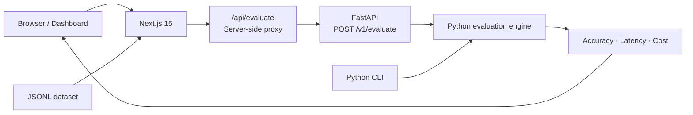

<div align="center">

# ◈ AgentMetrics AI

### Evaluate AI agents with evidence, not intuition.

**An open-source evaluation toolkit for reproducible AI-agent benchmarks.**  
Run labeled datasets, measure exact-match accuracy, latency and cost, and explore the results in a modern web dashboard.

[](LICENSE)
[](pyproject.toml)
[](apps/web/package.json)
[](src/agentmetrics/api.py)

**[Explore live dashboard](https://web-mrjoao28s-projects.vercel.app)** · **[API health](https://agentmetrics-api.onrender.com/health)** · **[Getting started](#-quick-start)** · **[Architecture](#-architecture)**

</div>

---

> [!IMPORTANT]
> **Public demo ≠ production benchmark.** The overview cards and charts use illustrative numbers. The interactive demo scenarios use synthetic records, but their displayed evaluation results are calculated by the actual Python engine. Never cite demo metrics as measured agent performance.

## ✨ Why AgentMetrics?

Evaluating an AI agent requires more than a convincing response. AgentMetrics provides a repeatable workflow for labeled examples, comparable metrics and transparent methodology.

| Capability | What it does | Status |
|:--|:--|:--|
| **Evaluation engine** | Compares expected and predicted outputs | ✅ Available |
| **Latency & cost** | Aggregates response times and reported USD costs | ✅ Available |
| **Interactive dashboard** | Runs evaluations via the Python API | ✅ Available |
| **JSONL import** | Imports up to 10,000 records / 2 MB in the web UI | ✅ Available |
| **Synthetic scenarios** | Lets visitors explore three labeled sample workloads | ✅ Available |
| **Bootstrap statistics** | Paired bootstrap utility in Python | 🧪 Library utility |
| **Persistent history** | Saved runs, teams and datasets | 🗓️ Planned |
| **Semantic evaluation** | LLM-as-judge / meaning-aware scoring | 🗓️ Planned |

## 🖥️ Explore the demo

**[Open the interactive dashboard →](https://web-mrjoao28s-projects.vercel.app)**

Try the preloaded scenarios without creating an account:

| Scenario | Synthetic examples | What it illustrates |
|:--|--:|:--|
| Customer support | 50 | Expected vs. predicted support responses |
| Ticket classification | 80 | Category agreement |
| Document extraction | 60 | Structured-field agreement |

Select a scenario and run the evaluation. The browser calls a Next.js server route, which forwards the request to the FastAPI service. You can also upload your own JSONL file.

> [!NOTE]
> The demo scenarios are **synthetic**. They do not call real AI agents or independently verify model quality. The current evaluator uses **normalized exact string matching**, not semantic correctness.

## 🏗️ Architecture



| Layer | Technology | Responsibility |
|:--|:--|:--|
| Web | Next.js, React, TypeScript | Dashboard and JSONL upload |
| API proxy | Next.js route handler | Server-side backend connection |
| API | FastAPI, Pydantic | Input validation and HTTP evaluation |
| Core | Python | Deterministic metrics and statistics |
| Deployment | Vercel + Render | Web frontend and Python service |

**Data flow:** your imported records are sent to the evaluation API for processing. There is no implemented persistent evaluation-history store. Avoid uploading sensitive or confidential data to the public demo.

## 🚀 Quick start

### Requirements

- Python **3.10+**
- Node.js and npm (for the web dashboard)
- Git

### 1. Clone and install the Python package

```bash
git clone https://github.com/mrJoao28/AgentMetrics-AI.git
cd AgentMetrics-AI
python -m venv .venv
```

Activate the environment:

```bash
# macOS / Linux
source .venv/bin/activate

# Windows PowerShell
.venv\Scripts\Activate.ps1
```

Then install:

```bash
python -m pip install -e ".[dev]"
```

### 2. Evaluate the included dataset

```bash
agentmetrics data/demo.jsonl
```

The CLI prints a JSON summary containing `count`, `exact_match_accuracy`, `mean_latency_ms` and `total_cost_usd`.

### 3. Start the API

```bash
uvicorn agentmetrics.api:app --reload --port 8000
```

API docs: **http://127.0.0.1:8000/docs**  
Health check: **http://127.0.0.1:8000/health**

### 4. Start the dashboard

Create `apps/web/.env.local`:

```dotenv
AGENTMETRICS_API_URL=http://127.0.0.1:8000
```

In a second terminal:

```bash
cd apps/web
npm install
npm run dev
```

Open **http://localhost:3000**. The environment variable is server-side: do **not** prefix it with `NEXT_PUBLIC_`.

## 🔌 API reference

### `POST /v1/evaluate`

Send one to 10,000 labeled records.

```bash
curl -X POST http://127.0.0.1:8000/v1/evaluate \
  -H "Content-Type: application/json" \
  -d '{"records":[{"expected":"approved","predicted":"approved","latency_ms":120,"cost_usd":0.001},{"expected":"denied","predicted":"approved","latency_ms":180,"cost_usd":0.002}]}'
```

Example response:

```json
{
  "count": 2,
  "exact_match_accuracy": 0.5,
  "mean_latency_ms": 150.0,
  "total_cost_usd": 0.003
}
```

| Field | Definition |
|:--|:--|
| `count` | Number of evaluated records |
| `exact_match_accuracy` | Fraction of normalized strings that match |
| `mean_latency_ms` | Arithmetic mean of recorded latency in milliseconds |
| `total_cost_usd` | Sum of user-provided per-record costs |

**Methodology:** exact match ignores leading/trailing whitespace and letter case. It does **not** assess semantic similarity, precision, recall, safety or hallucinations. Latency and cost are **supplied by the dataset**, not independently measured by the API.

### JSONL input

Each non-empty line must be one JSON object:

```jsonl
{"expected":"yes","predicted":"yes","latency_ms":120,"cost_usd":0.001}
{"expected":"no","predicted":"yes","latency_ms":210,"cost_usd":0.002}
```

`expected` and `predicted` are strings. `latency_ms` must be a non-negative finite number; `cost_usd` is optional and defaults to zero.

## 🧪 Development & quality

```bash
# From repository root
python -m pytest
python -m ruff check .

# From apps/web
npm run lint
npm run build
```

We aim for deterministic tests, reviewable feature branches, clear assumptions and reproducible datasets. See [live evaluation integration notes](docs/live-evaluation.md) for the proxy and deployment details.

## 🗺️ Roadmap

- [x] Python evaluation engine and CLI
- [x] FastAPI evaluation endpoint
- [x] Next.js dashboard with JSONL import
- [x] Interactive synthetic demo scenarios
- [x] MIT open-source license
- [ ] Persistent datasets and evaluation history
- [ ] Per-agent comparisons and trend analysis from real runs
- [ ] Confidence intervals surfaced in the web dashboard
- [ ] Exportable reports and benchmark reproducibility manifests
- [ ] Authentication and workspace management

Features marked as planned are **not yet available**.

## 🤝 Contributing

Contributions are welcome. Please open an issue describing the proposed change, create a focused feature branch, add or update tests where relevant, and submit a pull request with reproduction and validation steps. Never commit API keys, private prompts or sensitive datasets.

## 🔐 Responsible use

- Do not upload confidential customer data to the public demo.
- Do not present synthetic examples as measured production performance.
- Review evaluation methodology before making model-selection decisions.
- Protect the API before exposing it to untrusted, high-volume traffic.

## 📄 License & author

Licensed under the **[MIT License](LICENSE)**.

Created and maintained by **[João Felipe Azevedo](https://github.com/mrJoao28)**.

<div align="center">

**Build benchmarks people can understand, reproduce and trust.**

[Dashboard](https://web-mrjoao28s-projects.vercel.app) · [Source code](https://github.com/mrJoao28/AgentMetrics-AI) · [License](LICENSE)

</div>
